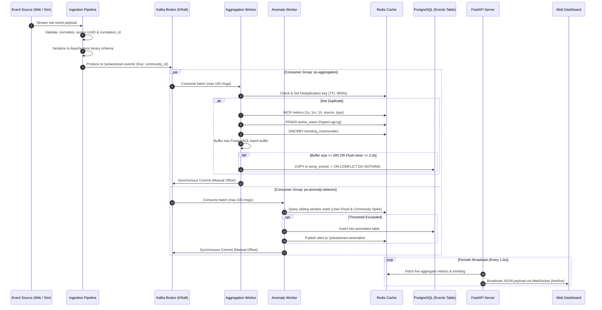
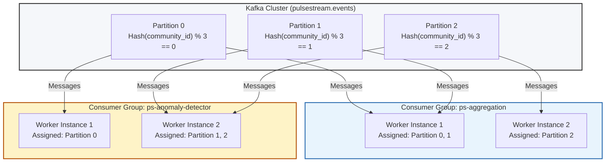
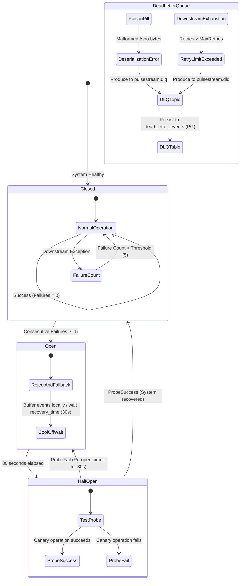

# PulseStream Architecture Documentation

This document provides a deep architectural overview of **PulseStream**, an enterprise-grade, distributed real-time streaming platform designed to ingest, process, aggregate, and monitor community engagement events at high velocity with sub-second latency and zero data loss.

---

## 1. System Overview

PulseStream processes real-time event streams from Wikipedia SSE (live edits, creations, categorizations) and synthetic event simulators. It routes events through a high-throughput **Apache Kafka** cluster, processes them using decoupled consumer groups running **at-least-once** with idempotent storage, aggregates rolling window analytics in **Redis**, archives immutable events into time-partitioned **PostgreSQL**, and streams live updates via **FastAPI WebSockets** to an interactive dashboard.

```
+-----------------------------------------------------------------------------------------------+
|                                      PULSESTREAM ARCHITECTURE                                 |
+-----------------------------------------------------------------------------------------------+
|                                                                                               |
|  [Wikipedia SSE]     [Synthetic Simulator]                                                    |
|         \                    /                                                                |
|          v                  v                                                                 |
|   +---------------------------------+                                                         |
|   |    Ingestion Pipeline Engine    |  (Kafka Producer, Avro Serializer, Concurrency Limiter) |
|   +---------------------------------+                                                         |
|                    |                                                                          |
|                    v (Partition Key: community_id)                                            |
|   +-------------------------------------------------------------+                             |
|   |                 Apache Kafka (KRaft Mode)                   |                             |
|   |  - Topic: pulsestream.events (3 Partitions, LZ4, 7d)        |                             |
|   |  - Topic: pulsestream.dlq    (1 Partition, Retention 14d)   |                             |
|   +-------------------------------------------------------------+                             |
|              |                                           |                                    |
|              v (Group: ps-aggregation)                   v (Group: ps-anomaly-detector)       |
|   +-----------------------------+             +-----------------------------+                 |
|   |     Aggregation Worker      |             |   Anomaly Detector Worker   |                 |
|   |  - Real-time Redis Counters |             |  - User Flood Windowing     |                 |
|   |  - HyperLogLog Active Users |             |  - Community Rate Spikes    |                 |
|   |  - Batch Staging to Postgres|             |  - Lag / Deserialization DLQ|                 |
|   +-----------------------------+             +-----------------------------+                 |
|              |                \                              |                                |
|              v                 v                             v                                |
|       [( Redis 7 )]     [( PostgreSQL 16 )]           [( Redis / PG )]                        |
|       - Sliding windows - Time-partitioned events     - Active anomalies                      |
|       - Fast deduplicat - Dead-letter events log      - Alert audit trail                     |
|              |                         |                     |                                |
|              +-------------------------+---------------------+                                |
|                                        |                                                      |
|                                        v                                                      |
|                        +-------------------------------+                                      |
|                        |      FastAPI REST & WS API    |                                      |
|                        +-------------------------------+                                      |
|                           /          |             \                                          |
|                          v           v              v                                         |
|                 [HTTP Endpoints] [WebSocket WS] [Prometheus /metrics]                         |
|                        |             |              |                                         |
|                        v             v              v                                         |
|                  [Web Clients] [Dashboard UI]  [Grafana Dashboards]                           |
+-----------------------------------------------------------------------------------------------+
```

---

## 2. End-to-End Data Flow

The diagram below illustrates the exact sequence and boundary crossings for an event traveling from ingestion to the end-user dashboard.



---

## 3. Consumer Group Topology & Scaling Model

PulseStream separates operational concerns by establishing independent Kafka Consumer Groups. Each consumer group maintains its own offset checkpoint in `__consumer_offsets`, ensuring that slow analytical queries or database batching never block real-time anomaly detection.



### Partitioning & Affinity
1. **Partition Key**: All events are produced with `key = event.community_id`.
2. **Per-Community Total Ordering**: Because all events for a given `community_id` hash to the exact same partition, per-community event order is strictly preserved.
3. **Independent Horizontal Scaling**:
   - The aggregation workers can scale up to the total number of topic partitions (3 in default local deployment, dynamically expandable in production).
   - Anomaly detector instances scale independently without impacting aggregation worker throughput.

---

## 4. Failure Handling, Circuit Breakers & DLQ Flow

Distributed stream processing systems must survive network partitions, downstream database exhaustion, and malformed poison pills without silent data loss.



### Fault-Tolerance Guarantees
1. **At-Least-Once Delivery**:
   - `enable.auto.commit = false` across all consumers. Offsets are only committed to Kafka *after* the event batch has been processed and stored in Redis and the local buffer.
2. **Idempotent Ingestion**:
   - **Redis Dedup**: Every event ID is recorded via `SETNX ps:dedup:{event_id} 1 EX 3600`. Duplicate arrivals from consumer rebalances or producer retries are immediately discarded.
   - **PostgreSQL Merge**: Bulk inserts execute via a staging table: `INSERT INTO events (...) SELECT ... FROM temp_events ON CONFLICT (event_id, timestamp) DO NOTHING`.
3. **Circuit Breakers**:
   - PostgreSQL inserts are protected by `CircuitBreaker(failure_threshold=5, recovery_timeout=30.0)`.
   - When PostgreSQL is down or lagging, events remain safely buffered in memory or backed up on Kafka's durable partition log.
4. **Dead Letter Queue (DLQ)**:
   - Poison pill messages (e.g. unparseable bytes, schema version mismatches) cannot crash workers. They are intercepted, tagged with stack traces, and routed to `pulsestream.dlq` and the `dead_letter_events` PostgreSQL table for operational triage.

---

## 5. Storage Architecture

### PostgreSQL Partitioning Strategy
The `events` table uses **declarative range partitioning** by `timestamp`.

```sql
CREATE TABLE events (
    event_id UUID NOT NULL,
    event_type VARCHAR(50) NOT NULL,
    source VARCHAR(50) NOT NULL,
    timestamp TIMESTAMPTZ NOT NULL,
    user_id VARCHAR(100),
    community_id VARCHAR(100) NOT NULL,
    payload JSONB NOT NULL DEFAULT '{}',
    ingested_at TIMESTAMPTZ NOT NULL DEFAULT NOW(),
    processed_at TIMESTAMPTZ NOT NULL DEFAULT NOW(),
    schema_version VARCHAR(10) NOT NULL DEFAULT '1.0.0',
    CONSTRAINT pk_events PRIMARY KEY (event_id, timestamp)
) PARTITION BY RANGE (timestamp);
```

- **Daily Partitions**: Partitions are provisioned daily (`events_y2026m09d17`, etc.).
- **Partition Pruning**: Time-bounded range queries (`WHERE timestamp >= NOW() - INTERVAL '1 hour'`) only touch current partitions, eliminating full-table scans.
- **High-Speed Ingestion**: Workers use `asyncpg` COPY protocol to write records directly to a temporary table in memory, executing single-transaction merge into partitioned storage.

### Redis Aggregations & Key Space
| Key Pattern | Redis Type | Purpose | TTL |
| :--- | :--- | :--- | :--- |
| `ps:dedup:{event_id}` | String | Idempotency deduplication | 3,600s (1 hr) |
| `ps:agg:events_per_sec:{timestamp}` | Counter | Real-time events per second throughput | 300s (5 min) |
| `ps:agg:events_today:{date}` | Counter | Total events processed today | 172,800s (48 hrs) |
| `ps:agg:type:{event_type}` | Counter | Cumulative breakdown by event type | None (Persistent) |
| `ps:agg:source:{source}` | Counter | Cumulative breakdown by ingestion source | None (Persistent) |
| `ps:agg:active_users:{window}` | HyperLogLog | Cardinality estimation of distinct users | 172,800s (48 hrs) |
| `ps:agg:community:{community_id}` | Counter | Per-community event count | None (Persistent) |
| `ps:agg:trending_communities` | Sorted Set | Top communities by current velocity | None (Persistent) |
| `ps:anom:user:{user_id}` | Sorted Set | Sliding window for user flood detection | 600s (10 min) |
| `ps:anom:community:{comm_id}`| Sorted Set | Sliding window for spike rate detection | 3,600s (1 hr) |

---

## 6. Observability & Telemetry

PulseStream includes production-grade observability baked into every component:

1. **Prometheus Metrics**:
   - `pulsestream_events_ingested_total` (counter by source, type, status)
   - `pulsestream_events_processed_total` (counter by worker, status)
   - `pulsestream_processing_duration_seconds` (histogram with p50, p95, p99 latency buckets)
   - `pulsestream_batch_size` (histogram of consumer batch sizes)
   - `pulsestream_db_insert_latency_seconds` (histogram of PostgreSQL batch COPY durations)
   - `pulsestream_anomalies_detected_total` (counter by rule and severity)
   - `pulsestream_dlq_events_total` (counter of malformed events routed to DLQ)
2. **Health Endpoints**:
   - `/health` on API (port 8000), Aggregation Worker (port 9101), and Anomaly Worker (port 9102).
   - Verifies active connectivity to Kafka Admin client, Redis ping, and PostgreSQL query pool.
3. **Structured Logging**:
   - Standardized JSON logs across all services containing `timestamp`, `level`, `logger`, `correlation_id`, and `service`.
