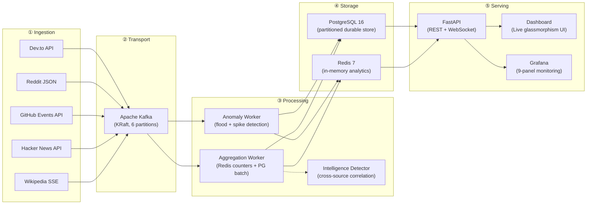
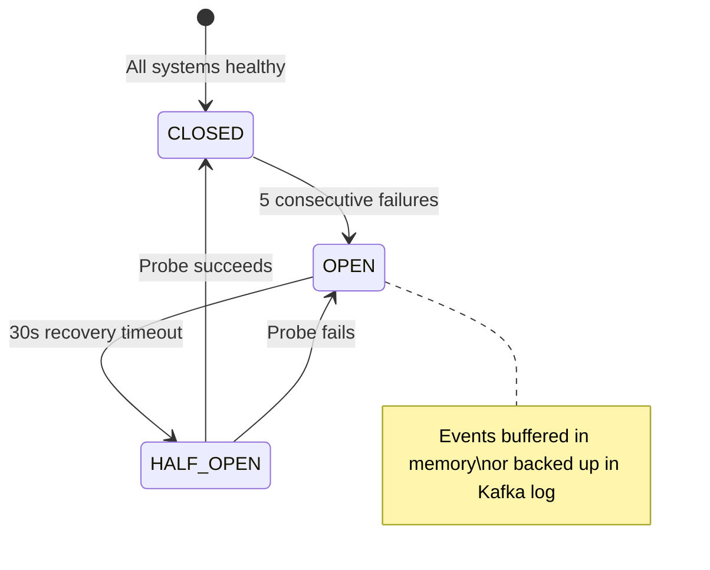

# PulseStream — Complete Project Deep Dive

## What Is PulseStream?

**PulseStream** is a **real-time event streaming and analytics platform**. Think of it like a miniature version of what companies like Datadog, Segment, or New Relic build internally — it continuously ingests live events from the internet (Wikipedia edits, Hacker News stories, GitHub pushes, Reddit posts, Dev.to articles), routes them through a distributed message bus, runs analytics and anomaly detection on them in real time, stores everything durably, and visualizes it all on a live dashboard.

> [!TIP]
> **In one sentence:** PulseStream is an end-to-end data pipeline that captures what's happening across the developer internet *right now*, detects interesting patterns, and shows it to you live.

---

## Architecture at 10,000 Feet

The system has **5 distinct layers**, each independently deployable:



---

## Layer-by-Layer Breakdown

### ① Ingestion Layer — *Capturing Live Data*

**Where:** [`src/ingestion/`](file:///C:/Users/Akhil%20Anwar/projects/Personal/pulse/project/src/ingestion)

**What it does:** Each "connector" is an async Python coroutine that polls or streams from an external API and converts raw responses into a normalized [`PulseStreamEvent`](file:///C:/Users/Akhil%20Anwar/projects/Personal/pulse/project/src/common/models.py#L47-L117).

| Connector | Source | Method | Key File |
|-----------|--------|--------|----------|
| Wikipedia | Wikimedia SSE `recentchange` | Server-Sent Events (persistent streaming) | [`wikipedia.py`](file:///C:/Users/Akhil%20Anwar/projects/Personal/pulse/project/src/ingestion/connectors/wikipedia.py) |
| Hacker News | Firebase API (`topstories`, `newstories`) | Polling every N seconds | [`hackernews.py`](file:///C:/Users/Akhil%20Anwar/projects/Personal/pulse/project/src/ingestion/connectors/hackernews.py) |
| GitHub | `/events` public timeline | Polling with ETag caching | [`github_events.py`](file:///C:/Users/Akhil%20Anwar/projects/Personal/pulse/project/src/ingestion/connectors/github_events.py) |
| Reddit | `/r/subreddit/new.json` | Polling with OAuth2 / fallback | [`reddit.py`](file:///C:/Users/Akhil%20Anwar/projects/Personal/pulse/project/src/ingestion/connectors/reddit.py) |
| Dev.to | `/api/articles` | Polling with pagination | [`devto.py`](file:///C:/Users/Akhil%20Anwar/projects/Personal/pulse/project/src/ingestion/connectors/devto.py) |
| Simulator | Synthetic generator | In-process (burst/flood modes) | [`simulator.py`](file:///C:/Users/Akhil%20Anwar/projects/Personal/pulse/project/src/ingestion/connectors/simulator.py) |

**How events flow:** Connectors → [`IngestionPipeline`](file:///C:/Users/Akhil%20Anwar/projects/Personal/pulse/project/src/ingestion/pipeline.py#L24-L145) → Avro serialize → Kafka produce.

**Key concepts to study:**
- **Apache Avro binary serialization** — Events are serialized to a strict binary schema ([`event.avsc`](file:///C:/Users/Akhil%20Anwar/projects/Personal/pulse/project/src/common/schemas/event.avsc)), reducing payload size by ~65% vs JSON
- **Partition key hashing** — Events are keyed by `community_id`, guaranteeing per-community ordering across Kafka partitions
- **Dead Letter Queue (DLQ)** — Malformed events that fail Avro validation get routed to `pulsestream.dlq` instead of crashing the pipeline

---

### ② Transport Layer — *Kafka as the Central Nervous System*

**Where:** [`docker-compose.yml` → `kafka`](file:///C:/Users/Akhil%20Anwar/projects/Personal/pulse/project/docker/docker-compose.yml#L2-L36)

**What it does:** Apache Kafka acts as a distributed, durable message buffer between producers (ingestion) and consumers (workers). Every event is durably stored in Kafka's log before any processing.

**Key design decisions:**
| Decision | Why |
|----------|-----|
| **KRaft mode** (no ZooKeeper) | Reduces memory from 1.5GB → <600MB, sub-5s cold starts ([ADR-001](file:///C:/Users/Akhil%20Anwar/projects/Personal/pulse/project/docs/adr/001-kafka-kraft-single-broker.md)) |
| **6 partitions** on `pulsestream.events` | Allows up to 6 parallel consumer instances per group |
| **Manual offset commits** (`auto.commit=false`) | Ensures events aren't lost if a worker crashes mid-batch ([ADR-002](file:///C:/Users/Akhil%20Anwar/projects/Personal/pulse/project/docs/adr/002-manual-commits-idempotent-processing.md)) |
| **LZ4 compression** | Low-CPU compression reducing network bandwidth |
| **Separate DLQ topic** (`pulsestream.dlq`) | Poison pills never block the main pipeline |

**Technology: Apache Kafka**
- Kafka is a distributed **commit log** — an append-only, ordered, durable stream of records
- **Producers** write to topic partitions; **consumers** read from them independently
- Multiple **consumer groups** can each read the full stream at their own pace

---

### ③ Processing Layer — *Where Analytics Happen*

**Where:** [`src/workers/`](file:///C:/Users/Akhil%20Anwar/projects/Personal/pulse/project/src/workers)

Two independent workers consume from the same Kafka topic via separate consumer groups:

#### Aggregation Worker ([`aggregator.py`](file:///C:/Users/Akhil%20Anwar/projects/Personal/pulse/project/src/workers/aggregation/aggregator.py))

For each event batch, it:
1. **Deduplicates** via Redis `SETNX` (idempotent — same event processed twice won't be counted twice)
2. **Increments Redis counters** — events/sec, events/day, per-source, per-type, per-community
3. **HyperLogLog active users** — counts unique users using only 12KB of memory per window ([ADR-004](file:///C:/Users/Akhil%20Anwar/projects/Personal/pulse/project/docs/adr/004-hyperloglog-active-users.md))
4. **Updates trending communities** via Redis sorted sets (`ZINCRBY`)
5. **Buffers events** in memory, flushing to PostgreSQL via the COPY protocol when the buffer hits 500 events or 2 seconds elapse

#### Anomaly Detection Worker ([`src/workers/anomaly/`](file:///C:/Users/Akhil%20Anwar/projects/Personal/pulse/project/src/workers/anomaly))

Evaluates streaming rules:
- **User flood detection** — If one user generates >50 events in 10 seconds → anomaly
- **Community spike detection** — If a community's rate exceeds 10× its rolling hourly average → anomaly

#### Cross-Source Intelligence ([`cross_source.py`](file:///C:/Users/Akhil%20Anwar/projects/Personal/pulse/project/src/workers/intelligence/cross_source.py))

Detects when the same topic trends simultaneously across multiple sources (e.g., a repo trending on GitHub AND Hacker News AND Reddit → cross-source surge alert).

#### Base Worker Framework ([`base.py`](file:///C:/Users/Akhil%20Anwar/projects/Personal/pulse/project/src/workers/base.py))

All workers extend this abstract class which provides:
- Kafka consumer loop with batch polling
- Redis deduplication hooks
- DLQ routing for poison pills
- Prometheus metrics collection
- Health check HTTP server
- Circuit breakers for PostgreSQL and Redis
- Graceful shutdown with signal traps

---

### ④ Storage Layer — *Dual-Store Architecture*

#### Redis 7 — *Hot/Real-Time Data*

| Key Pattern | Type | Purpose |
|-------------|------|---------|
| `ps:dedup:{event_id}` | String | 1-hour TTL deduplication cache |
| `ps:agg:events_today:*` | Counter | Total events processed today |
| `ps:agg:type:*` | Counter | Breakdown by event type |
| `ps:agg:source:*` | Counter | Breakdown by source |
| `ps:agg:active_users:*` | HyperLogLog | Unique user cardinality (12KB!) |
| `ps:agg:trending_communities` | Sorted Set | Top communities by velocity |
| `ps:anom:user:*` | Sorted Set | Sliding windows for flood detection |

#### PostgreSQL 16 — *Cold/Durable Data*

```sql
CREATE TABLE events (...) PARTITION BY RANGE (timestamp);
-- Daily partitions: events_y2026m09d28, etc.
```

- **Range partitioning** by timestamp → queries like `WHERE timestamp >= NOW() - '1 hour'` only scan today's partition
- **Idempotent inserts** via `ON CONFLICT (event_id, timestamp) DO NOTHING`
- **COPY protocol** for bulk inserts (much faster than individual INSERT statements)
- Separate tables for `anomalies` and `dead_letter_events`

---

### ⑤ Serving Layer — *Dashboard & APIs*

#### FastAPI REST API ([`src/api/`](file:///C:/Users/Akhil%20Anwar/projects/Personal/pulse/project/src/api))

| Endpoint | What It Does |
|----------|-------------|
| `GET /api/v1/events` | Query historical events from PostgreSQL with filters |
| `GET /api/v1/metrics` | Real-time counters from Redis |
| `GET /api/v1/anomalies` | Active anomaly alerts |
| `GET /api/v1/health` | Deep health probe (Kafka + Redis + PG connectivity) |
| `WS /ws/live` | WebSocket broadcasting live metrics every 1 second |
| `GET /api/v1/intelligence/*` | Cross-source dossiers and surge alerts |

#### Dashboard ([`src/dashboard/`](file:///C:/Users/Akhil%20Anwar/projects/Personal/pulse/project/src/dashboard))

A vanilla JS dark-mode glassmorphism UI showing:
- Live event velocity (events/sec ticker)
- KPI cards (total events, active users, anomalies)
- Trending communities table
- Source breakdown (Wikipedia, HN, GitHub, Reddit, Dev.to)
- Interactive event browser

---

## Resilience & Fault Tolerance

PulseStream is designed to never lose data:



| Failure | Protection |
|---------|-----------|
| Worker crash mid-batch | Manual Kafka offset commits — offsets only advance after successful processing |
| Duplicate events (rebalance/retry) | Redis `SETNX` + PostgreSQL `ON CONFLICT DO NOTHING` |
| Malformed/corrupt payloads | Caught, wrapped with stack traces, routed to DLQ |
| Redis down | Circuit breaker trips → graceful degradation (events still flow) |
| PostgreSQL down | Circuit breaker → events buffer in memory and Kafka log |

Validated by the [chaos engineering test suite](file:///C:/Users/Akhil%20Anwar/projects/Personal/pulse/project/tests/chaos/test_chaos.py).

---

## Technology Stack Reference

| Technology | Version | Role | Why This Choice |
|-----------|---------|------|-----------------|
| **Python** | 3.11+ | Application language | Async-first with `asyncio`, rich ecosystem |
| **Apache Kafka** | 3.7+ (KRaft) | Distributed message bus | Durable, ordered, scalable event streaming |
| **PostgreSQL** | 16 | Durable storage | Declarative partitioning, JSONB, COPY protocol |
| **Redis** | 7 | Real-time cache & analytics | HyperLogLog, sorted sets, sub-ms latency |
| **FastAPI** | 0.115+ | HTTP/WS API server | Async native, auto OpenAPI docs, WebSocket support |
| **Apache Avro** | — | Binary serialization | Schema enforcement, compact wire format |
| **confluent-kafka** | — | Kafka client library | High-performance C-based Python bindings |
| **asyncpg** | — | PostgreSQL driver | Fastest Python PG driver, COPY protocol support |
| **Pydantic** | v2 | Data validation | Type-safe domain models with validators |
| **Prometheus** | 2.54 | Metrics collection | Industry-standard time-series metrics |
| **Grafana** | 11.1 | Dashboards & alerting | Pre-provisioned monitoring panels |
| **Docker Compose** | — | Orchestration | Single-command infrastructure management |
| **Ruff** | — | Linting & formatting | Fast Python linter/formatter |

---

## Learning Path — How to Go Deeper

### Level 1: Understand the Data Flow (Start Here)
1. Read [`src/common/models.py`](file:///C:/Users/Akhil%20Anwar/projects/Personal/pulse/project/src/common/models.py) — Understand the `PulseStreamEvent` domain model
2. Read [`src/common/schemas/event.avsc`](file:///C:/Users/Akhil%20Anwar/projects/Personal/pulse/project/src/common/schemas/event.avsc) — The Avro schema every event must conform to
3. Read [`src/ingestion/pipeline.py`](file:///C:/Users/Akhil%20Anwar/projects/Personal/pulse/project/src/ingestion/pipeline.py) — Follow an event from raw dict → normalized → Avro → Kafka

### Level 2: Understand Connectors
4. Read [`src/ingestion/connectors/wikipedia.py`](file:///C:/Users/Akhil%20Anwar/projects/Personal/pulse/project/src/ingestion/connectors/wikipedia.py) — SSE streaming pattern
5. Read [`src/ingestion/connectors/hackernews.py`](file:///C:/Users/Akhil%20Anwar/projects/Personal/pulse/project/src/ingestion/connectors/hackernews.py) — Polling pattern
6. Read [`src/ingestion/main.py`](file:///C:/Users/Akhil%20Anwar/projects/Personal/pulse/project/src/ingestion/main.py) — How connectors are orchestrated as concurrent async tasks

### Level 3: Understand Processing
7. Read [`src/workers/base.py`](file:///C:/Users/Akhil%20Anwar/projects/Personal/pulse/project/src/workers/base.py) — The worker framework (Kafka consumer loop, dedup, DLQ)
8. Read [`src/workers/aggregation/aggregator.py`](file:///C:/Users/Akhil%20Anwar/projects/Personal/pulse/project/src/workers/aggregation/aggregator.py) — Redis updates + PG batch staging
9. Read [`src/common/retry.py`](file:///C:/Users/Akhil%20Anwar/projects/Personal/pulse/project/src/common/retry.py) — Circuit breaker state machine

### Level 4: Understand Infrastructure
10. Read [`docker/docker-compose.yml`](file:///C:/Users/Akhil%20Anwar/projects/Personal/pulse/project/docker/docker-compose.yml) — All 7 services and their dependencies
11. Read [`docker/configs/postgresql/init.sql`](file:///C:/Users/Akhil%20Anwar/projects/Personal/pulse/project/docker/configs/postgresql/init.sql) — Database schema with partitioning
12. Read the [ADR directory](file:///C:/Users/Akhil%20Anwar/projects/Personal/pulse/project/docs/adr) — Architectural decision records explain *why* things are built this way

### Level 5: Deep Concepts to Study
| Concept | Where in PulseStream | External Resource |
|---------|---------------------|-------------------|
| Kafka consumer groups & offsets | `base.py` manual commits | [Kafka: The Definitive Guide](https://www.confluent.io/resources/kafka-the-definitive-guide/) |
| HyperLogLog probabilistic counting | `aggregator.py` PFADD | [Redis HyperLogLog docs](https://redis.io/docs/data-types/probabilistic/hyperloglogs/) |
| Circuit Breaker pattern | `retry.py` | [Martin Fowler's Circuit Breaker](https://martinfowler.com/bliki/CircuitBreaker.html) |
| PostgreSQL range partitioning | `init.sql` | [PG Partitioning docs](https://www.postgresql.org/docs/16/ddl-partitioning.html) |
| COPY protocol (bulk inserts) | `db.py` batch insert | [asyncpg COPY docs](https://magicstack.github.io/asyncpg/current/api/index.html) |
| Avro binary serialization | `avro_utils.py` | [Apache Avro spec](https://avro.apache.org/docs/current/specification/) |
| Server-Sent Events (SSE) | `wikipedia.py` | [MDN SSE guide](https://developer.mozilla.org/en-US/docs/Web/API/Server-sent_events) |

---

## Quick Commands Reference

```bash
# Start all infrastructure
docker compose -f docker/docker-compose.yml up -d

# Run tests (105 tests)
pytest tests/unit tests/integration -v

# Run chaos engineering tests
pytest tests/chaos -v -s

# Launch individual services (in separate terminals)
make ingestion     # Connectors + Kafka producer
make agg-worker    # Redis aggregation + PG staging
make anomaly-worker # Anomaly detection rules
make api           # FastAPI + Dashboard on :8000
```

| URL | Service |
|-----|---------|
| http://localhost:8000 | Dashboard |
| http://localhost:8000/docs | API Swagger docs |
| http://localhost:3000 | Grafana (admin/admin) |
| http://localhost:9090 | Prometheus |
